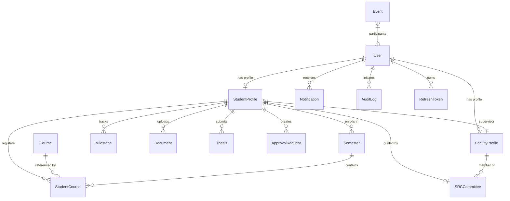

# Document.md — System Architecture & Logic Specification

> **Project:** NIT Jamshedpur — CSE PhD Scholar Management Portal  
> **Repository Structure:** Monorepo (`backend/` + `frontend/`)  
> **Source of Truth:** Aligned with Project SRS (`Requirement.txt`) and NIT Jamshedpur PhD Regulations 2024 (`PhD_new.pdf`).

---

## 1. Project Directory Topology

```text
CSE_portal/
├── AGENTS.md                      → Agentic workflow, subagent guidelines, git & frontend rules
├── Requirement.txt                → Full Software Requirements Specification (SRS v1.0)
├── context.md                     → Developer handoff, operational state, environment & gotchas
├── document.md                    → (This file) Architecture, logic mapping, API and component catalog
├── backend.md                     → Backend API reference with payloads and parameters
├── package.json                   → Monorepo root scripts (concurrently dev/build/test/typecheck)
├── backend/                       → Node.js + Express + TypeScript + MongoDB Backend
│   ├── .env                       → Live configuration (Atlas URI, JWT secret, SMTP credentials)
│   ├── .env.example               → Template environment file
│   ├── package.json               → Backend scripts and dependencies
│   ├── tsconfig.json              → TypeScript compiler configuration
│   └── src/
│       ├── app.ts                 → Express server initialization, middleware wiring, scheduler start
│       ├── config/
│       │   ├── db.ts              → Mongoose connection handler
│       │   └── env.ts             → Environment variable validation via dotenv
│       ├── controllers/
│       │   ├── authController.ts         → Registration, OTP verification, login, refresh, logout
│       │   ├── studentController.ts      → Student self-service, profile, courses, thesis, timeline
│       │   ├── supervisorController.ts   → Assigned scholars, approvals, event scheduling
│       │   ├── adminController.ts        → Global management, SRC, deadlines, user lifecycle
│       │   └── bulkImportController.ts   → Excel/CSV parser, batch import (students/faculty/events)
│       ├── middleware/
│       │   ├── auth.ts            → JWT authentication & Role-Based Access Control (RBAC)
│       │   └── errorHandler.ts    → AppError class, centralized error handling & asyncHandler
│       ├── models/                → 20 Mongoose Schemas & Models
│       │   ├── User.ts            → Core authentication entity (student / supervisor / admin)
│       │   ├── StudentProfile.ts  → Scholar academic profile, department, FRP/ERP, credits
│       │   ├── FacultyProfile.ts  → Supervisor/faculty academic & department profile
│       │   ├── Semester.ts        → Dynamic semester records
│       │   ├── Course.ts          → Course master catalog
│       │   ├── StudentCourse.ts   → Course registration & supervisor approval link
│       │   ├── Credits.ts         → Semester-wise and cumulative credit aggregates
│       │   ├── Document.ts        → Uploaded academic documents (metadata + storage URLs)
│       │   ├── Form.ts            → Downloadable institutional and academic forms
│       │   ├── Thesis.ts          → Thesis submissions and multi-version tracking
│       │   ├── Supervisor.ts      → Scholar-to-supervisor assignment mapping
│       │   ├── SRCCommittee.ts    → Student Research Committee composition records
│       │   ├── Event.ts           → Academic meetings, seminars, and comprehensive exams
│       │   ├── Deadline.ts        → System and academic deadlines with scheduler tracking
│       │   ├── Notification.ts    → In-app notifications
│       │   ├── ApprovalRequest.ts → Generic student-to-supervisor approval requests
│       │   ├── AuditLog.ts        → Immutable audit trails (NFR-06 compliance)
│       │   ├── OTP.ts             → Bcrypt-hashed OTP records for email verification
│       │   ├── Milestone.ts       → 11-step mandatory PhD milestone tracker
│       │   └── RefreshToken.ts    → Refresh token persistence for silent JWT re-issuance
│       ├── routes/
│       │   ├── authRoutes.ts         → `/api/auth` endpoints
│       │   ├── studentRoutes.ts      → `/api/student` endpoints
│       │   ├── supervisorRoutes.ts   → `/api/supervisor` endpoints
│       │   └── adminRoutes.ts        → `/api/admin` endpoints (including bulk import)
│       ├── services/
│       │   ├── milestoneService.ts   → Milestone seeding, checklist progression, status updates
│       │   ├── creditService.ts      → Dynamic credit aggregation from approved coursework
│       │   └── deadlineService.ts    → Background scheduler (6h interval) + automated email dispatch
│       ├── types/
│       │   └── index.ts              → Unified TypeScript interfaces, enums, request extensions
│       └── utils/
│           ├── audit.ts              → Audit log generation helper
│           ├── email.ts              → Nodemailer transport with Gmail SMTP & HTML templates
│           ├── notify.ts             → In-app notification creation & bulk dispatch
│           ├── otp.ts                → OTP crypto generation, bcrypt hashing & verification
│           ├── pagination.ts         → Generic pagination helper for MongoDB queries
│           ├── participants.ts       → StudentProfile/User ID resolution for event invites
│           ├── response.ts           → Standardized JSON success/error response wrappers
│           └── seedAdmin.ts          → Boot-time admin account provisioning from `.env`
└── frontend/                      → React 19 + Vite 6 + Tailwind CSS v4 + TypeScript Client
    ├── index.html                 → Application root HTML template
    ├── package.json               → Frontend scripts and dependencies
    ├── vite.config.ts             → Vite config with proxy `/api` → `http://localhost:5000`
    ├── tsconfig.json              → Strict TypeScript configuration
    └── src/
        ├── main.tsx               → React DOM root mount
        ├── App.tsx                → BrowserRouter, Route hierarchy, ProtectedRoute, Lazy imports
        ├── index.css              → Tailwind v4 styles and CSS design tokens
        ├── api/                   → Strongly-typed API client modules
        │   ├── client.ts          → Axios-free fetch wrapper, silent refresh, 429 rate limit
        │   ├── auth.ts            → Auth API endpoints (login, register, OTP, logout, me)
        │   ├── student.ts         → Student self-service API client
        │   ├── supervisor.ts      → Supervisor portal API client
        │   └── admin.ts           → Admin operations API client (including bulk import)
        ├── context/
        │   └── AuthContext.tsx    → Global authentication, session restoration, role state
        ├── hooks/
        │   ├── useApi.ts          → Declarative data fetching hook (loading, error, refetch)
        │   └── usePageTitle.ts    → Dynamic document title synchronizer
        ├── components/
        │   ├── layout/            → DashboardLayout, Header, Sidebar, MobileNav, navConfig
        │   ├── shared/            → PageHeader, ProtectedRoute, ErrorBoundary, StatCard, etc.
        │   └── ui/                → Accessible UI primitives (Button, Table, Modal, Tabs, etc.)
        └── pages/
            ├── auth/              → LoginPage, RegisterPage, VerifyOtpPage
            ├── student/           → 11 scholar views (Dashboard, Courses, Milestones, Thesis, etc.)
            ├── supervisor/        → 5 supervisor views (Dashboard, StudentList, Approvals, Detail)
            ├── admin/             → 10 admin views (Dashboard, Students, Faculty, BulkImport, etc.)
            └── NotFoundPage.tsx   → 404 handler
```

---

## 2. Technology Stack & Matrix

| Layer | Technologies & Packages | Purpose |
|---|---|---|
| **Runtime & Language** | Node.js (v20+), TypeScript 5.5+ (Strict) | End-to-end type safety across backend and client |
| **Backend Framework** | Express 4.21, ts-node-dev | REST API server with live reload in development |
| **Database & ODM** | MongoDB Atlas, Mongoose 8.6 | Document database with rigid schemas, indexes, and validation |
| **Authentication & Tokens** | JSON Web Tokens (`jsonwebtoken`), `bcryptjs` | Access token (15m expiry) + Refresh token (7d expiry) + salt cost 12 |
| **Email & Notifications** | `nodemailer` (Gmail SMTP / port 587) | OTP distribution, event invitations, automated deadline warnings |
| **File Import & Parsing** | `multer` (in-memory), `xlsx` | Multi-format (CSV, XLS, XLSX) batch ingestion for students, faculty, events |
| **Security & Middleware** | `helmet`, `cors`, `express-rate-limit` | HTTP headers hardening, origin filtering, 100 req / 15 min throttle |
| **Testing (Backend)** | Jest 29, `mongodb-memory-server`, `supertest` | Isolated, zero-dependency unit and integration test suites |
| **Frontend Framework** | React 19, Vite 6 (`@vitejs/plugin-react`) | High-performance SPA with instant HMR and ES module bundling |
| **Frontend Styling** | Tailwind CSS v4 (`@tailwindcss/vite`) | Zero-runtime CSS design system adhering to strict professional aesthetic |
| **Routing** | React Router DOM v6 (`BrowserRouter`) | Lazy-loaded code-split routes with nested role-based guards |
| **Testing (Frontend)** | Vitest 3, Testing Library, JSDOM | Fast component and API client verification |

---

## 3. SRS Requirements to Code Implementation Mapping

### 3.1 Authentication & User Lifecycle (SRS §4)

| Feature | Backend Implementation | Frontend Implementation | Architectural Notes |
|---|---|---|---|
| **FR-01: Student Registration** | `authController.registerStudent` | `pages/auth/RegisterPage.tsx` | Validates duplicate email/rollNumber; creates `User` (inactive) + `StudentProfile`; auto-seeds 11 default milestones; sends OTP via email. |
| **FR-01: OTP Generation & Dispatch** | `utils/otp.ts` → `utils/email.ts` | `pages/auth/VerifyOtpPage.tsx` | 6-digit numeric OTP; bcrypt-hashed into `OTP` collection; 10 min TTL. Falls back to console log if SMTP is unconfigured. |
| **FR-01: Verify OTP** | `authController.verifyOTP` | `pages/auth/VerifyOtpPage.tsx` | Validates hash and expiry; marks `User.isActive = true`; returns initial access & refresh JWT tokens. |
| **FR-02: User Login** | `authController.login` | `pages/auth/LoginPage.tsx` | Validates bcrypt password; verifies `isActive`; returns JWT `{ id, role, email }` + persists refresh token. |
| **FR-03: Faculty Authentication** | `adminController.createFaculty` + `authController.login` | `pages/admin/FacultyManagement.tsx` | Faculty accounts are provisioned exclusively by Administrators (`isActive: true`). Public registration is blocked. |
| **FR-04: System Admin Bootstrapping** | `utils/seedAdmin.ts` | N/A (CLI / Boot) | Triggered at server start (`app.ts`); reads `ADMIN_EMAIL` and `ADMIN_PASSWORD` from `.env`; creates admin account if absent. |
| **FR-05: First-Login Profile Onboarding** | `studentController.updateProfile` | `pages/student/StudentOnboarding.tsx` | If `isProfileComplete: false`, student is routed to `/student/complete-profile` to fill phone, DOB, gender, category, and prior degrees. |
| **Ext: Silent Token Refresh** | `authController.refreshToken` | `api/client.ts` (`refreshAccessToken`) | Re-issues 15m access token using 7d refresh token stored in `localStorage`; handles 401s gracefully without page reloads. |
| **Ext: Password Management** | `authController.changePassword` | Settings / Profile modal | Requires current password validation; enforces bcrypt hashing (cost 12); updates user record. |

---

### 3.2 Student Self-Service & Academic Tracking (SRS §5–§10)

| Feature | Backend Implementation | Frontend Implementation | Architectural Notes |
|---|---|---|---|
| **FR-06: View Profile** | `studentController.getProfile` | `pages/student/StudentProfile.tsx` | Returns user details, academic info, supervisor, co-supervisor, and populated SRC committee members. |
| **FR-07: Edit Profile** | `studentController.updateProfile` | `pages/student/StudentProfile.tsx` | Scholars can only modify `name`, `researchArea`, `profilePhoto`, and personal fields. Institutional fields are admin-only. Writes to `AuditLog`. |
| **FR-08: Admin Profile Editing** | `adminController.updateStudent` | `pages/admin/StudentManagement.tsx` | Administrators can update all profile fields, college ID, roll number, student type (FRP/ERP), and required credits. |
| **FR-09: Dynamic Semester Records** | `studentController.createSemester`, `getSemesters` | `pages/student/StudentCourses.tsx` | Semesters are not hardcoded. Created dynamically with academic year, start, and end dates (SRS OD-05). |
| **FR-10: Semester Overview Dashboard** | `supervisorController.getStudentDetail` | `pages/supervisor/StudentDetail.tsx` | Aggregates semester-by-semester courses, credits, uploaded documents, thesis history, and timeline. |
| **FR-11: Degree Timeline** | `studentController.getTimeline` | `pages/student/StudentMilestones.tsx` | Synthesizes an end-to-end timeline from Semesters, Course approvals, Milestones, and Thesis milestones. |
| **FR-12: View Courses** | `studentController.getCourses` | `pages/student/StudentCourses.tsx` | Scoped to student and selected semester; displays code, name, credits, and supervisor approval status. |
| **FR-13: View Credits** | `studentController.getCredits` | `pages/student/StudentCredits.tsx` | Auto-computes earned credits from approved courses via `creditService.ts`. Compares against `requiredCredits` (12 or 20). |
| **FR-14: Add Course Work** | `studentController.addCourse` | `pages/student/StudentCourses.tsx` | Registers a course under a semester; creates `StudentCourse` with status `pending` for supervisor evaluation. |
| **FR-15: Course Approval** | `supervisorController.approveCourse` | `pages/supervisor/Approvals.tsx` | Verifies supervisor-scholar relationship; transitions status (`approved` / `rejected`); logs audit; notifies scholar. |
| **FR-16–19: Forms Management** | `studentController.getMyForms`, `adminController.*Form` | `pages/student/StudentDashboard.tsx`, `pages/admin/FormManagement.tsx` | Institutional forms filtered by `applicableStudentType` (all/frp/erp) and semester applicability; stored with cloud URLs. |
| **FR-20–23: Academic Documents** | `studentController.uploadDocument`, `getDocuments` | `pages/student/StudentDocuments.tsx` | Stores document metadata (`fileUrl`, type, semester); supports marksheets, synopsis, fee receipts; tracks supervisor review. |
| **FR-24: Thesis Upload & Versioning** | `studentController.submitThesis`, `getThesis` | `pages/student/StudentThesis.tsx` | Multi-version thesis tracker; increments version counter automatically; preserves previous draft history. |
| **FR-25: Thesis Review & Approval** | `supervisorController.approveThesis` | `pages/supervisor/Approvals.tsx` | Supports transitions: `submitted` → `under_review` → `approved` / `rejected` / `resubmission_required`; sends alerts. |
| **Ext: Student Milestones** | `studentController.getMyMilestones` | `pages/student/StudentMilestones.tsx` | Visual progress tracker across the 11 NIT Jamshedpur statutory PhD milestones; reflects live status and due dates. |

---

### 3.3 Supervisor Oversight & Academic Workflows (SRS §11–§13)

| Feature | Backend Implementation | Frontend Implementation | Architectural Notes |
|---|---|---|---|
| **FR-26: Supervisor Assignment** | `adminController.assignSupervisor` | `pages/admin/SupervisorAssignment.tsx` | Admin assigns main supervisor and optional co-supervisor. Deactivates previous supervisor record (`isActive: false`). |
| **FR-27: General Student Requests** | `supervisorController.approveRequest` | `pages/supervisor/Approvals.tsx` | Handles `ApprovalRequest` records (leave, course exemption, SRC modification) with approval or rejection remarks. |
| **FR-28: Supervisor Dashboard** | `supervisorController.getDashboard` | `pages/supervisor/SupervisorDashboard.tsx` | Displays live counts of assigned scholars, pending course requests, pending thesis drafts, and upcoming events. |
| **FR-29: Filter Assigned Students** | `supervisorController.getAssignedStudents` | `pages/supervisor/StudentList.tsx` | Supports query filtering by name, roll number, semester, student type (frp/erp), and research area. |
| **FR-30: Create Academic Event** | `supervisorController.createEvent` | `pages/supervisor/SupervisorEvents.tsx` | Schedules seminars, SRC reviews, or viva-voce exams with title, date, start/end time, venue, or online meeting link. |
| **FR-31: Multi-Student Scheduling** | `utils/participants.ts` | `components/shared/ParticipantPicker.tsx` | Resolves mixed User/StudentProfile IDs into unique User IDs; creates single event; bulk creates notifications & emails. |
| **FR-32: Eligible Student Filtering** | `supervisorController.getEligibleStudents` | `pages/supervisor/SupervisorEvents.tsx` | Endpoint `/students/options` provides a quick lookup list of eligible scholars assigned to the requesting supervisor. |
| **FR-33: Admin Event Management** | `adminController.createEvent/update/delete` | `pages/admin/EventManagement.tsx` | Full administrative control to schedule, edit, or cancel events for any faculty or student group. |
| **Ext: Supervisor Milestone Control** | `supervisorController.updateMilestone` | `pages/supervisor/StudentDetail.tsx` | Supervisors can update milestone status (`completed`, `in_progress`), set completion timestamps, or adjust target dates. |

---

### 3.4 SRC (Student Research Committee) Lifecycle (SRS §14)

| Feature | Backend Implementation | Frontend Implementation | Architectural Notes |
|---|---|---|---|
| **FR-34: SRC Formation** | `adminController.createSRCCommittee` | `pages/admin/SrcCommitteeManagement.tsx` | Enforces regulatory composition: exactly **1 Chairperson**, assigned **Supervisor**, optional **Co-Supervisor**, and **Members**. |
| **FR-35: Member Nomination** | `supervisorController.approveRequest` | `pages/supervisor/Approvals.tsx` | Supervisor requests for committee changes are routed through the standard `ApprovalRequest` pipeline. |
| **FR-36: Committee Reconstitution** | `adminController.updateSRCCommittee` | `pages/admin/SrcCommitteeManagement.tsx` | Replaces committee member list while validating chairperson exclusivity; preserves audit history in `AuditLog`. |
| **FR-37: View SRC Committee** | `studentController.getProfile`, `supervisorController.getStudentDetail` | `pages/student/StudentProfile.tsx`, `pages/supervisor/StudentDetail.tsx` | Populates faculty details (name, employeeId, department) alongside their specific SRC roles. |

---

### 3.5 Automated Notifications & Communication Engine (SRS §15)

| Feature | Backend Implementation | Frontend Implementation | Architectural Notes |
|---|---|---|---|
| **FR-38: In-App Notifications** | `utils/notify.ts` → `Notification` model | `pages/student/StudentNotifications.tsx`, Header bell | Persistent in-app notifications with read/unread tracking, category tagging, and direct URL routing. |
| **FR-39: Automated Deadline Warnings** | `services/deadlineService.ts` | `pages/student/StudentDeadlines.tsx`, `pages/admin/DeadlineManagement.tsx` | Background scheduler runs at boot and every **6 hours**; finds unnotified deadlines within 7 days; sends in-app & emails. |
| **FR-40: Outbound Email Engine** | `utils/email.ts` (`sendNotificationEmail`) | Console log (Dev) / SMTP (Prod) | HTML-formatted emails with institutional branding for OTPs, event invitations, and urgent deadline alerts. |
| **FR-41: Faculty Notification Triggers** | `controllers/*` | `pages/supervisor/SupervisorDashboard.tsx` | Triggered automatically on course submission, thesis upload, account activation, or committee change. |

---

### 3.6 Institutional Administration & Bulk Ingestion (SRS §16)

| Feature | Backend Implementation | Frontend Implementation | Architectural Notes |
|---|---|---|---|
| **FR-42: Student Administration** | `adminController.createStudent/list/update/toggle` | `pages/admin/StudentManagement.tsx` | Filterable list, toggle active state, update personal & academic info, manage milestone progress directly. |
| **FR-43: Faculty Administration** | `adminController.createFaculty/list/update/toggle` | `pages/admin/FacultyManagement.tsx` | Provision faculty accounts, update designations and departments, toggle access. |
| **FR-44: Global System Search** | `adminController.globalSearch` | `pages/admin/GlobalSearch.tsx` | Multi-entity regex search querying College IDs, Roll Numbers, Employee IDs, Names, and Emails. |
| **Ext: Bulk Excel/CSV Import** | `controllers/bulkImportController.ts` | `pages/admin/BulkImport.tsx` | High-throughput batch import for Students, Faculty, and Events. Includes template downloads and row-by-row error auditing. |
| **Ext: Admin Milestone Oversight** | `adminController.getStudentMilestones`, `updateMilestone` | `pages/admin/StudentManagement.tsx` (Modal) | Dedicated endpoint `/students/:id/milestones` allowing admin to inspect and override scholar milestones. |

---

## 4. Database Architecture & Data Models

The system defines 20 collections in MongoDB via Mongoose schemas:



### 4.1 Schema Specifications

| Collection | Schema File | Key Fields & Types | Indexes & Constraints |
|---|---|---|---|
| `users` | `src/models/User.ts` | `email` (String), `password` (String, select: false), `name` (String), `role` (`student`\|`supervisor`\|`admin`), `isActive` (Boolean) | Unique: `email` |
| `studentprofiles` | `src/models/StudentProfile.ts` | `user` (Ref: User), `collegeId` (String), `rollNumber` (String), `studentType` (`frp`\|`erp`), `department` (String), `requiredCredits` (Number, def: 12), `supervisor` (Ref: FacultyProfile), `isProfileComplete` (Boolean) | Unique: `collegeId`, `rollNumber` |
| `facultyprofiles` | `src/models/FacultyProfile.ts` | `user` (Ref: User), `employeeId` (String), `department` (String), `designation` (String), `researchInterests` ([String]) | Unique: `employeeId` |
| `semesters` | `src/models/Semester.ts` | `student` (Ref: StudentProfile), `semesterNumber` (Number), `academicYear` (String), `startDate` (Date), `endDate` (Date), `status` (`ongoing`\|`completed`) | Compound: `{ student: 1, semesterNumber: 1 }` |
| `courses` | `src/models/Course.ts` | `courseCode` (String), `courseName` (String), `credits` (Number), `department` (String), `syllabusUrl` (String) | Unique: `courseCode` |
| `studentcourses` | `src/models/StudentCourse.ts` | `student` (Ref: StudentProfile), `semester` (Ref: Semester), `course` (Ref: Course), `status` (`pending`\|`approved`\|`rejected`), `approvedBy` (Ref: User) | Compound: `{ student: 1, course: 1, semester: 1 }` |
| `milestones` | `src/models/Milestone.ts` | `student` (Ref: StudentProfile), `key` (MilestoneKey enum), `title` (String), `status` (`pending`\|`in_progress`\|`completed`\|`skipped`), `order` (Number), `dueDate` (Date), `completedAt` (Date) | Unique compound: `{ student: 1, key: 1 }` |
| `srccommittees` | `src/models/SRCCommittee.ts` | `student` (Ref: StudentProfile), `members`: `[{ faculty: Ref FacultyProfile, role: chairperson\|supervisor\|co_supervisor\|member }]`, `formationDate` (Date) | Unique: `student` |
| `theses` | `src/models/Thesis.ts` | `student` (Ref: StudentProfile), `title` (String), `abstract` (String), `documentUrl` (String), `version` (Number), `status` (`submitted`\|`under_review`\|`approved`\|`rejected`\|`resubmission_required`) | Index: `student` |
| `events` | `src/models/Event.ts` | `title` (String), `eventType` (Enum), `date` (Date), `startTime` (String), `endTime` (String), `venue` (String), `participants`: `[{ participant: Ref User, participantModel: 'User' }]` | Index: `date`, `participants.participant` |
| `deadlines` | `src/models/Deadline.ts` | `title` (String), `dueDate` (Date), `semester` (Ref: Semester), `student` (Ref: StudentProfile), `notificationSent` (Boolean) | Index: `dueDate`, `notificationSent` |
| `notifications` | `src/models/Notification.ts` | `recipient` (Ref: User), `title` (String), `message` (String), `type` (Enum), `isRead` (Boolean), `link` (String) | Index: `{ recipient: 1, isRead: 1 }` |
| `refreshtokens` | `src/models/RefreshToken.ts` | `token` (String), `user` (Ref: User), `expiresAt` (Date), `revoked` (Boolean) | TTL Index: `expiresAt` |
| `auditlogs` | `src/models/AuditLog.ts` | `user` (Ref: User), `action` (String), `entity` (String), `entityId` (String), `previousValue` (Mixed), `newValue` (Mixed) | Index: `{ entity: 1, entityId: 1 }`, `user` |
| `otps` | `src/models/OTP.ts` | `email` (String), `otp` (String, bcrypt hash), `expiresAt` (Date), `verified` (Boolean) | TTL Index: `expiresAt` |

---

## 5. API Route Directory

All endpoints are hosted under `http://localhost:5000/api` with JSON request/response formats.

### 5.1 Authentication Routes (`/api/auth`)
| Method | Endpoint | Auth | Description |
|---|---|---|---|
| `POST` | `/register` | Public | Register new PhD student, seed milestones, send verification OTP |
| `POST` | `/verify-otp` | Public | Verify OTP, activate user, return access + refresh tokens |
| `POST` | `/login` | Public | Authenticate user, return JWT tokens |
| `POST` | `/refresh` | Public | Re-issue access token using valid refresh token |
| `POST` | `/logout` | Public | Revoke stored refresh token |
| `GET` | `/me` | Any | Fetch current logged-in user and linked profile |
| `PUT` | `/change-password` | Any | Change authenticated user password |

### 5.2 Student Routes (`/api/student`)
| Method | Endpoint | Description |
|---|---|---|
| `GET` | `/dashboard` | Aggregated dashboard (profile, credits, milestones, deadlines, thesis) |
| `GET` | `/profile` | Complete scholar profile with supervisor and SRC details |
| `PUT` | `/profile` | Update scholar-editable fields (`name`, `researchArea`, `profilePhoto`) |
| `GET` | `/semesters` | List all dynamic semesters for scholar |
| `POST` | `/semesters` | Create new semester record |
| `GET` | `/semesters/:id/courses` | List registered courses for a semester |
| `POST` | `/semesters/:id/courses` | Request course registration (pending supervisor approval) |
| `GET` | `/credits` | Fetch dynamic credit summary (`earned`, `required`, `remaining`) |
| `GET` | `/milestones` | Fetch 11-step statutory milestone progress checklist |
| `GET` | `/documents` | List uploaded academic documents |
| `POST` | `/documents` | Register document upload metadata |
| `GET` | `/thesis` | List all submitted thesis drafts and versions |
| `POST` | `/thesis` | Submit new thesis version for evaluation |
| `GET` | `/timeline` | Synthesized degree timeline |
| `GET` | `/events` | List events scholar is participant of (`?upcoming=true`) |
| `GET` | `/deadlines` | List deadlines scoped to student (`?upcoming=true`) |
| `GET` | `/forms` | Institutional forms applicable to student type/semester |
| `GET` | `/notifications` | View in-app notifications |
| `PUT` | `/notifications/:id/read` | Mark individual notification as read |

### 5.3 Supervisor Routes (`/api/supervisor`)
| Method | Endpoint | Description |
|---|---|---|
| `GET` | `/dashboard` | Supervisor overview (assigned count, pending approvals, events) |
| `GET` | `/students` | Paginated and filtered list of assigned PhD scholars |
| `GET` | `/students/options` | Lightweight lookup list of assigned scholars for event pickers |
| `GET` | `/students/:studentId` | Full academic dossier of a student (courses, credits, documents) |
| `PUT` | `/courses/:id/approve` | Approve or reject student coursework request |
| `PUT` | `/thesis/:id/approve` | Review and evaluate thesis submission |
| `PUT` | `/approvals/:id/approve` | Resolve general student approval request |
| `PUT` | `/milestones/:id` | Update milestone progress for an assigned scholar |
| `GET` | `/events` | List supervisor-scheduled events |
| `POST` | `/events` | Schedule seminar, meeting, or examination |
| `GET` | `/approvals/pending` | Unified inbox of all pending supervisor approvals |

### 5.4 Admin Routes (`/api/admin`)
| Method | Endpoint | Description |
|---|---|---|
| `GET` | `/dashboard` | System-wide statistics (scholars, faculty, events, pending queues) |
| `GET` | `/students` | Paginated search and list of all scholars |
| `POST` | `/students` | Manually provision new PhD scholar |
| `GET` | `/students/:id/milestones` | Inspect scholar milestone checklist |
| `PUT` | `/students/:id` | Modify any scholar profile field |
| `PUT` | `/students/:id/toggle-active` | Activate or suspend scholar account |
| `GET` | `/faculty` | Paginated search and list of all faculty |
| `POST` | `/faculty` | Provision new faculty member account |
| `PUT` | `/faculty/:id` | Modify faculty profile details |
| `PUT` | `/faculty/:id/toggle-active` | Activate or suspend faculty account |
| `POST` | `/supervisor/assign` | Assign supervisor and co-supervisor to scholar |
| `POST` | `/src-committee` | Constitute new SRC Committee (enforces 1 chairperson rule) |
| `PUT` | `/src-committee/:id` | Reconstitute existing SRC Committee |
| `PUT` | `/milestones/:id` | Override any scholar milestone status/date |
| `GET` | `/events` | List all institutional events |
| `POST` | `/events` | Create institutional event with multi-participant invites |
| `PUT` | `/events/:id` | Update event details |
| `DELETE` | `/events/:id` | Remove event |
| `GET` | `/forms` | List institutional downloadable forms |
| `POST` | `/forms` | Publish new form metadata |
| `PUT` | `/forms/:id` | Edit form metadata |
| `DELETE` | `/forms/:id` | Delete form |
| `GET` | `/deadlines` | List all institutional deadlines |
| `POST` | `/deadlines` | Create deadline and queue for scheduler alerts |
| `GET` | `/bulk-import/template/:type` | Download Excel import template (`students`, `faculty`, `events`) |
| `POST` | `/bulk-import/:type` | Ingest Excel/CSV spreadsheet with batch validation |
| `GET` | `/search` | Global cross-entity search (scholars and faculty) |

---

## 6. Frontend Architecture & Page Directory

The client application is built with React 19 and Tailwind CSS v4, utilizing route-based code splitting (`React.lazy`) wrapped in a single Suspense boundary.

```mermaid
graph TD
    Root["App Root (/)"] --> AuthGuard{"Authenticated?"}
    AuthGuard -- No --> Login["/auth/login"]
    AuthGuard -- Yes --> RoleSwitch{"User Role"}
    
    RoleSwitch -- student --> S_Dash["/student (Dashboard)"]
    RoleSwitch -- supervisor --> Sup_Dash["/supervisor (Dashboard)"]
    RoleSwitch -- admin --> A_Dash["/admin (Dashboard)"]
    
    subgraph StudentPortal["Student Portal (/student)"]
        S_Dash
        S_Prof["/profile"]
        S_Mile["/milestones"]
        S_Course["/courses"]
        S_Cred["/credits"]
        S_Thesis["/thesis"]
        S_Event["/events"]
        S_Dead["/deadlines"]
        S_Doc["/documents"]
        S_Notif["/notifications"]
        S_Onboard["/complete-profile"]
    end
    
    subgraph SupervisorPortal["Supervisor Portal (/supervisor)"]
        Sup_Dash
        Sup_List["/students"]
        Sup_Det["/students/:studentId"]
        Sup_App["/approvals"]
        Sup_Ev["/events"]
    end
    
    subgraph AdminPortal["Admin Portal (/admin)"]
        A_Dash
        A_Stud["/students"]
        A_Fac["/faculty"]
        A_Ass["/assignments"]
        A_SRC["/src-committees"]
        A_Forms["/forms"]
        A_Dead["/deadlines"]
        A_Ev["/events"]
        A_Bulk["/bulk-import"]
        A_Search["/search"]
    end
```



### 6.1 State Management & Authentication Flow
- **`AuthContext.tsx`**: Restores active session on reload via `GET /api/auth/me`. Stores access token (`cse_portal_token`) and refresh token (`cse_portal_refresh`) in `localStorage`.
- **`api/client.ts`**: Provides `apiFetch`, `apiUpload`, and `apiDownload`. Handles JWT Bearer attachment, token expiration intercepts with automatic call to `/api/auth/refresh`, and HTTP 429 Retry-After header parsing.
- **`ProtectedRoute.tsx`**: Ensures routes are protected by role. Renders `<Outlet />` inside `DashboardLayout` to avoid nested route swallowing.

---

## 7. Institutional Ordinance Compliance (NIT Jamshedpur 2024)

### 7.1 Statutory PhD Milestones (`MilestoneKey`)
The system strictly enforces the sequential 11-stage journey defined in the 2024 ordinance:
1. `admission` — Admission & Enrollment completed.
2. `src_formed` — Student Research Committee officially constituted.
3. `course_work` — Completion of prescribed credit coursework (minimum CGPA required).
4. `comprehensive_exam` — Written and oral comprehensive examination cleared.
5. `topic_registration` — Provisional research topic registered following research seminar.
6. `enhancement_seminar` — State-of-the-Art / Research enhancement seminar presented.
7. `pre_submission` — Pre-submission seminar delivered before SRC.
8. `thesis_submitted` — Final thesis draft officially submitted.
9. `thesis_approved` — Board of examiners evaluation and approval received.
10. `defense` — Viva-voce / Oral defense successfully defended.
11. `degree_awarded` — Formal degree awarded at institute convocation.

### 7.2 Credit Requirements
- **FRP / Regular Scholars (Post-Master's Admission):** Minimum **12 credits**.
- **Direct-Admission Scholars (Post-Bachelor's Admission):** Minimum **20 credits**.
- Credits are automatically calculated via `creditService.ts` from approved coursework only (`status === 'approved'`).

### 7.3 SRC Committee Composition Rules
Enforced in `adminController.createSRCCommittee` and `adminController.updateSRCCommittee`:
- Exactly **one** member with role `chairperson` (from CSE department).
- Exactly **one** member with role `supervisor` (must match the assigned supervisor).
- Optional `co_supervisor`.
- At least **two** departmental faculty members and **one** allied department member.

---

## 8. Build, Test, and Execution Commands

All commands can be executed from the workspace root:

```bash
# Install dependencies across root, backend, and frontend
npm install
npm --prefix backend install
npm --prefix frontend install

# Development Mode (runs backend on :5000 and frontend on :5173 concurrently)
npm start
# or
npm run dev

# Full Stack Compilation & Type Checking
npm run typecheck
npm run build

# Automated Test Suites (Jest for backend, Vitest for frontend)
npm test
```